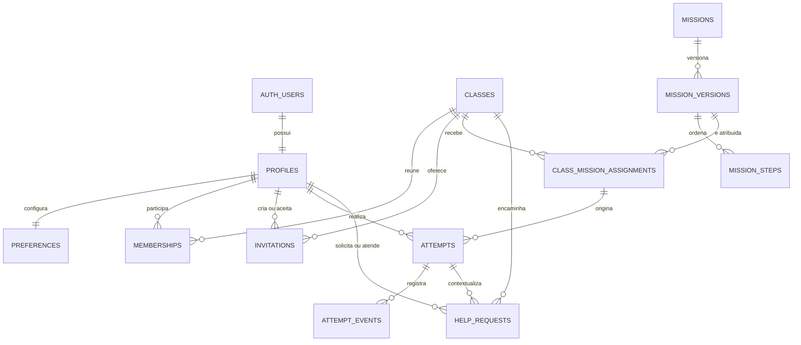

# Modelo de dados inicial do MVP

Este documento apresenta o esquema criado pela migração
`supabase/migrations/202608230001_initial_product_model.sql`. O Postgres é a
fonte de verdade; este desenho serve para leitura e revisão do domínio.

## Princípios

- `auth.users.id` é a identidade estável. E-mail não é chave de autorização.
- O papel não é global nem informado pelo aplicativo: ele pertence a um vínculo
  ativo entre pessoa e turma em `memberships`.
- Uma pessoa pode ser participante em uma turma e monitor em outra, sem duplicar
  a conta Google.
- Conteúdo de missão é imutável por versão. Tentativas e eventos apontam para a
  versão praticada, preservando o histórico.
- IDs são UUIDs e horários são `timestamptz`.
- Tabelas expostas têm RLS habilitada e acesso anônimo é negado por padrão.
- Fotos, localização, dados bancários e gravações de voz reais não fazem parte
  deste modelo. As missões persistem apenas conteúdo e eventos de simulação.

## Relações



## Entidades

| Tabela | Responsabilidade | Invariantes principais |
| --- | --- | --- |
| `profiles` | Nome e avatar associados ao usuário autenticado | PK/FK para `auth.users`; criada automaticamente no primeiro login. |
| `preferences` | Acessibilidade, áudio, voz, idioma e onboarding | Uma linha por perfil; o usuário só acessa a própria linha. |
| `classes` | Turma de aprendizagem | Estado `active` ou `archived`; somente membros ativos leem. |
| `memberships` | Papel de uma pessoa dentro de uma turma | Único por turma, pessoa e papel; `participant` ou `monitor`; revogação é server-side. |
| `invitations` | Autorização prévia para entrar em uma turma | E-mail normalizado, hash SHA-256 do token, expiração e consumo único; token puro não é salvo. |
| `missions` | Identidade estável do item de catálogo | Slug único, categoria, dificuldade, duração e estado. |
| `mission_versions` | Conteúdo publicável de uma missão | Versão crescente por missão; no máximo uma versão publicada por vez. |
| `mission_steps` | Passos, instruções, áudio, dicas e ação esperada | Posição única na versão; objetos e listas são validados como JSON. |
| `class_mission_assignments` | Liberação de uma versão para uma turma | Criada por monitor ativo; janela de disponibilidade e obrigatoriedade opcionais. |
| `attempts` | Execução de uma missão por participante | Vínculo, turma, versão e atribuição coerentes por FKs compostas; só uma tentativa em andamento por atribuição. |
| `attempt_events` | Linha do tempo append-only da tentativa | Sequência única por tentativa e payload JSON; suporta reenvio idempotente por ID. |
| `help_requests` | Pedido contextual de ajuda ao monitor | Pertence à mesma turma/tentativa; estados `open`, `in_progress`, `resolved` ou `cancelled`. |

## Autorização inicial

| Recurso | Participante | Monitor |
| --- | --- | --- |
| Perfil | Lê e atualiza o próprio | Lê o próprio e perfis vinculados às suas turmas |
| Turma e vínculos | Lê as próprias turmas e vínculos | Lê vínculos das turmas monitoradas |
| Convites | Sem acesso direto | Cria e lê convites de participante da própria turma |
| Catálogo | Lê missões ativas e versões publicadas | Mesmo acesso de leitura |
| Atribuições | Lê as da própria turma | Cria, altera e arquiva nas turmas monitoradas |
| Tentativas e eventos | Cria e lê somente os próprios | Somente leitura nas turmas monitoradas |
| Preferências | Lê e altera somente as próprias | Lê e altera somente as próprias |
| Pedidos de ajuda | Cria e lê somente os próprios | Lê e atende os pedidos das turmas monitoradas |

Criação de turma, ativação/revogação de vínculo, consumo de convite e publicação
de conteúdo não têm policy de escrita para o cliente. Essas operações serão feitas
por função server-side autenticada e auditável nas issues correspondentes.

## Estados relevantes

```text
membership: active → inactive
mission version: draft → published → retired
assignment: scheduled → active → archived
attempt: in_progress → completed | abandoned
help request: open → in_progress → resolved
                         └────────→ cancelled
```

Estados fechados não são reabertos pelo cliente. Triggers também impedem a troca
dos campos de identidade de tentativas, atribuições e pedidos de ajuda depois da
criação.

## Evolução do schema

Migrações são forward-only e imutáveis depois de promovidas. Para alterar o
modelo, crie um novo arquivo com `npm run backend:migration:new -- nome`, faça um
reset local completo e revise FKs, índices, grants e policies RLS. O seed contém
somente catálogo sintético e nunca deve receber dados de produção.
