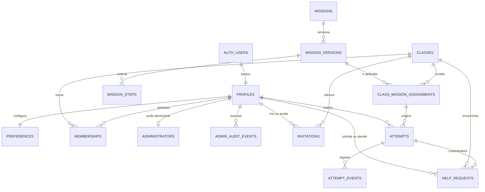

# Modelo de dados inicial do MVP

Este documento apresenta o esquema criado pelas migrações em
`supabase/migrations/`, incluindo o endurecimento de autorização e as projeções
persistidas da migração `202608240002_persisted_class_context.sql`. O Postgres é a
fonte de verdade; este desenho serve para leitura e revisão do domínio.

## Princípios

- `auth.users.id` é a identidade estável. E-mail não é chave de autorização.
- O aluno possui vínculo ativo em `memberships`. `admin` é o único papel global,
  existe em `administrators` e nunca é escolhido ou enviado pelo aplicativo.
- Pode haver vários administradores globais ativos. O banco impede a revogação
  ou exclusão do último, evitando que o ambiente fique sem administração.
- Uma conta pode ser aluno e administrador sem duplicar a identidade Google.
  A migração `202609020002_finalize_admin_student_roles.sql` converte acessos antigos,
  remove vínculos legados e deixa o enum somente com `participant` e `admin`.
- Conteúdo de missão é imutável por versão. Tentativas e eventos apontam para a
  versão praticada, preservando o histórico.
- IDs são UUIDs e horários são `timestamptz`.
- Tabelas expostas têm RLS habilitada e acesso anônimo é negado por padrão.
- Fotos, localização, dados bancários e gravações de voz reais não fazem parte
  deste modelo. As missões persistem apenas conteúdo e eventos de simulação.

## Relações



## Entidades

| Tabela | Responsabilidade | Invariantes principais |
| --- | --- | --- |
| `profiles` | Nome, avatar e estado da conta autenticada | PK/FK para `auth.users`; nasce `pending`, só acessa o domínio quando `active` e perde acesso imediatamente quando `blocked`. |
| `preferences` | Acessibilidade, áudio, voz, idioma e onboarding | Uma linha por perfil; o usuário só acessa a própria linha. |
| `classes` | Turma de aprendizagem | Estado `active` ou `archived`; somente membros ativos leem. |
| `memberships` | Vínculo de um aluno com uma turma | Único por turma e pessoa; novos vínculos ativos são sempre `participant`; revogação é server-side. |
| `administrators` | Concessão do papel global de maior privilégio | Vários admins podem estar ativos; o último ativo não pode ser removido; escrita apenas server-side. |
| `admin_audit_events` | Rastro mínimo de operações administrativas | Registra ator, ação, alvo, turma e horário; não armazena nome, e-mail, token ou conteúdo livre. |
| `invitations` | Autorização prévia para entrar em uma turma | RPC gera token criptográfico, persiste somente SHA-256, limita a sete dias, consome uma vez e não expõe o hash. |
| `missions` | Identidade estável do item de catálogo | Slug único, categoria, dificuldade, duração e estado. |
| `mission_versions` | Conteúdo publicável de uma missão | Versão crescente por missão; no máximo uma versão publicada por vez. |
| `mission_steps` | Passos, instruções, áudio, dicas e ação esperada | Posição única na versão; objetos e listas são validados como JSON. |
| `class_mission_assignments` | Liberação de uma versão para uma turma | Criada por administrador; janela de disponibilidade e obrigatoriedade opcionais. |
| `attempts` | Execução de uma missão por participante | Vínculo, turma, versão e atribuição coerentes por FKs compostas; só uma tentativa em andamento por atribuição. |
| `attempt_events` | Linha do tempo append-only da tentativa | RPC deriva autoria, valida a janela temporal e oferece retry idempotente sem atualizar a linha. |
| `help_requests` | Pedido contextual de ajuda à administração | Pertence à mesma turma/tentativa; estados `open`, `in_progress`, `resolved` ou `cancelled`. |

No domínio do produto, `memberships` representa os **class memberships**. O nome
físico existente foi preservado para evitar renomear FKs e migrações já
promovidas.

## Projeções para o aplicativo

- `get_my_class_contexts()` retorna somente turmas ativas e vínculos ativos da
  identidade autenticada. Uma identidade Google pode aparecer em mais de uma
  turma e possuir papéis diferentes sem duplicar `profiles`.
- `get_admin_class_participants(class_id)` exige administrador global e retorna
  perfil mínimo e métricas agregadas da turma; não expõe e-mail,
  metadata ou eventos brutos.
- `get_admin_participant(class_id, participant_id)` aplica a mesma fronteira e
  não confirma participantes de outra turma.
- `get_participant_mission_catalog()` projeta as atribuições disponíveis dos
  vínculos ativos da pessoa. Toda conta Google verificada recebe um vínculo
  invisível com a turma pública **Comunidade Celular Sem Medo**, e toda versão
  publicada é automaticamente atribuída a essa turma. Assim, o catálogo é
  universal mesmo sem vínculo com uma turma de oficina; rascunhos nunca chegam
  ao aplicativo.
- `get_participant_mission_details(assignment_id)` e
  `get_participant_mission_steps(assignment_id)` reutilizam essa fronteira. IDs
  inválidos ou pertencentes a outra turma retornam conjunto vazio, sem revelar a
  existência do conteúdo.
- criação, listagem e consumo de convites continuam restritos às RPCs seguras,
  com token de uso único e validade máxima de sete dias.

## Autorização inicial

Esta tabela descreve a fundação criada na primeira migração. O contrato normativo
e os testes obrigatórios estão em
[`docs/privacy/authorization-and-logging.md`](../privacy/authorization-and-logging.md).
Antes de production, as policies precisam ser fortalecidas para exigir conta,
turma e vínculo ativos de forma uniforme e para projetar somente as colunas
necessárias ao administrador.

| Recurso | Aluno | Admin global |
| --- | --- | --- |
| Perfil | Lê e atualiza o próprio | Lê perfis para administrar contas; alterações sensíveis são server-side |
| Turma e vínculos | Lê as próprias turmas e vínculos | Lê todas as turmas; revoga vínculos por RPC auditada |
| Convites | Sem acesso direto | Cria convites somente de aluno e lê todos para suporte operacional |
| Catálogo | Lê missões ativas e versões publicadas | Lê e administra todo o catálogo |
| Atribuições | Lê as da própria turma | Gerencia em todas as turmas |
| Tentativas e eventos | Cria e lê somente os próprios | Lê para suporte, segurança e operação |
| Preferências | Lê e altera somente as próprias | Leitura excepcional para suporte; alteração negada |
| Pedidos de ajuda | Cria e lê somente os próprios | Lê e atualiza em todas as turmas |

Criação de turma, ativação/revogação de vínculo e publicação de conteúdo não têm
policy de escrita para o cliente. Convites são criados, listados e consumidos por
RPCs autenticadas; as demais operações serão feitas por função server-side
auditável nas issues correspondentes.

## Lacunas conhecidas de privacidade

A migração inicial não implementa ainda o ciclo completo da Issue #2:

- FKs de autoria e histórico impedem apagar uma conta com um simples
  `DELETE auth.users`; a purga precisa de transação idempotente e tombstones;
- o participante ainda não possui RPC para cancelar o próprio pedido de ajuda;
- a execução periódica das rotinas de retenção ainda precisa ser homologada no
  ambiente de produção;
- exclusão e exportação devem ser exercitadas com dados reais antes do lançamento.

O inventário técnico, a ordem de exclusão e a evidência esperada estão em
[`docs/privacy/rights-and-operations.md`](../privacy/rights-and-operations.md#lacunas-técnicas-que-bloqueiam-production).
Essas lacunas ficam explícitas para que a fundação não seja confundida com uma
autorização pronta para dados reais.

## Estados relevantes

```text
membership: active → inactive
mission version: draft → published → retired
assignment: scheduled → active → archived
attempt: in_progress → completed | abandoned
help request: open → in_progress → resolved
                         └────────→ cancelled
```

Os triggers impedem reabrir tentativas e pedidos de ajuda fechados e protegem os
campos de identidade de tentativas, atribuições e pedidos depois da criação.
Transições de `classes` e `class_mission_assignments` ainda não têm máquina de
estados: o grant atual permite, por exemplo, `archived → active`. A próxima
migração deve definir transições autorizadas e correção administrativa auditada.

## Evolução do schema

Migrações são forward-only e imutáveis depois de promovidas. Para alterar o
modelo, crie um novo arquivo com `npm run backend:migration:new -- nome`, faça um
reset local completo e revise FKs, índices, grants e policies RLS. O seed contém
somente catálogo sintético e nunca deve receber dados de produção.
