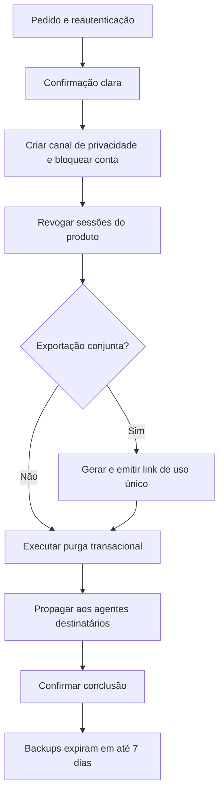

# Direitos dos titulares e operação de privacidade

Este documento transforma a política em fluxos operacionais. Os prazos são SLAs
do produto, exceto quando a obrigação legal específica estiver indicada.

## Canais e acessibilidade

O MVP deve oferecer os mesmos direitos por dois caminhos:

- dentro do app: **Perfil → Privacidade e dados**;
- sem o app e sem login: `[PREENCHER URL /privacidade/escolhas]`, com atalhos
  diretos para `[PREENCHER /excluir-conta]` e `[PREENCHER /exportar-dados]`.

As páginas públicas devem funcionar com leitor de tela, zoom de texto e teclado,
usar linguagem simples e não esconder a ação em uma política genérica. O canal
humano de privacidade continua disponível para quem precisa de assistência, mas
não é barreira obrigatória para iniciar exclusão ou exportação.

## Catálogo de direitos e SLA

| Pedido | Comportamento | SLA do produto |
| --- | --- | --- |
| Confirmação simplificada | Mostrar na Central de Privacidade se a conta possui dados e as categorias principais | Imediato quando autenticado |
| Acesso completo/exportação | Gerar pacote dos dados do próprio titular, com glossário | Até 15 dias corridos; a declaração completa de acesso tem prazo legal de até 15 dias |
| Correção | Permitir editar campos controlados pela pessoa; claims Google devem ser corrigidas na origem quando aplicável | Imediato no autosserviço; até 15 dias se exigir análise |
| Informação de compartilhamento | Exibir fornecedores, instituições e finalidade vigentes | Imediato pela política/inventário; resposta individual em até 15 dias |
| Exclusão, anonimização ou bloqueio | Bloquear conta, revogar sessões e executar o plano abaixo | Bloqueio imediato; banco ativo em até 15 dias |
| Revogação de consentimento | Desligar a finalidade opcional sem prejudicar as demais funções | Imediato |
| Oposição/revisão | Suspender a operação contestada quando seguro e avaliar base, necessidade e efeito | Confirmação imediata; decisão em até 15 dias |
| Portabilidade | Entregar formato interoperável quando aplicável e conforme regulamentação | Até 15 dias como SLA interno |

O prazo interno uniforme de 15 dias é uma decisão mais protetiva do produto. A
LGPD não fixa 15 dias para todos os direitos. Se um pedido não puder ser atendido
de imediato ou integralmente, a resposta informa motivo, dados retidos, hipótese
e prazo, sem resposta genérica.

## Verificação de identidade

1. Uma sessão ativa exige reautenticação Google/Supabase recente antes de
   exportar, excluir, trocar e-mail ou revogar todos os dispositivos.
2. Quem perdeu o acesso pode iniciar pelo canal público. A verificação usa a
   alternativa menos invasiva disponível e nunca pede senha, token ou código
   OAuth.
3. Documento oficial não é solicitado por padrão. Se excepcionalmente necessário,
   a imagem não entra nos logs e é apagada logo após a verificação.
4. O protocolo público usa identificador aleatório. E-mail, nome e detalhes do
   pedido não aparecem na URL ou em analytics.
5. Solicitações repetidas ou suspeitas recebem avaliação proporcional, sem
   inviabilizar o direito.

Representante legalmente constituído pode exercer o direito nos termos do art.
18, §3º. O canal verifica identidade e poderes com o mínimo de dados, limita o
acesso ao pedido representado e descarta cópias comprobatórias quando a verificação
termina, salvo retenção fundamentada. Ser monitor, familiar ou integrante da mesma
turma não cria representação automática da pessoa participante.

## Exportação de dados

### Escopo

O pacote contém apenas dados da pessoa solicitante:

- perfil e preferências;
- papéis, turmas e vínculos próprios;
- missões atribuídas, tentativas, eventos e indicadores próprios;
- pedidos de ajuda feitos pela pessoa e resoluções recebidas;
- consentimentos e solicitações de privacidade;
- glossário com origem, eventual inexistência de registro, critérios, finalidade e
  significado dos campos.

A exportação de uma pessoa que também é monitor **não inclui os participantes**
que ela pode consultar no trabalho. Access/refresh/ID tokens, cookies, hashes de
convite e segredos são excluídos. Dados pessoais da solicitante presentes em
registros de segurança ou antifraude continuam sujeitos ao direito de acesso;
somente segredos, dados de terceiros ou trechos cuja restrição tenha fundamento
explicado são redigidos.

### Entrega

1. Uma função server-side recebe a solicitação autenticada e ignora qualquer
   `user_id` enviado pelo cliente, usando apenas o sujeito da sessão.
2. A consulta usa uma transação consistente e política própria de exportação; não
   reutiliza o acesso amplo de monitor.
3. O resultado é um ZIP criptografado em storage privado, contendo JSON e CSV em
   UTF-8, versão imprimível acessível em HTML/PDF e manifesto de versão/checksum.
4. A pessoa recebe dentro da sessão um link assinado, de uso único, válido por no
   máximo 15 minutos. O arquivo expira em até 24 horas e nunca é anexado aberto a
   e-mail.
5. Download, expiração e descarte geram somente eventos sanitizados.
6. Uma forma impressa é disponibilizada quando solicitada, com verificação e
   entrega adequadas.
7. Quando exportação e exclusão forem pedidas juntas, o backend cria antes da
   revogação uma credencial aleatória, de uso estritamente limitado a consultar o
   pedido/baixar o pacote. As sessões normais e operações do produto são
   bloqueadas imediatamente; o job gera e emite o link por esse canal separado e
   então inicia a purga, sem depender do download. Essa credencial não é uma
   sessão do app e expira junto com o arquivo; o link continua limitado a 15
   minutos.

## Exclusão de conta

A exclusão é da conta do Celular Sem Medo, não da Conta Google. Ela deve existir
no app e em página web pública para atender Android e iOS.

### Comportamento e prazo

1. A tela explica consequência, prazo, dados que eventualmente precisam ser
   mantidos e que a Conta Google continuará existindo.
2. Após a confirmação, o backend cria o job/canal estreito de privacidade quando
   necessário, bloqueia a conta, revoga todas as sessões normais e remove a pessoa
   da visão operacional dos monitores imediatamente.
3. Se houver exportação conjunta, o pacote e o link são emitidos pelo canal
   separado antes da purga, como definido acima; ele não reabre acesso ao app.
4. O grant Google é desconectado quando
   a biblioteca tiver recebido credencial revogável; o MVP não persiste provider
   access/refresh token. Caso Sign in with Apple seja adicionado, a credencial
   Apple também é revogada conforme o protocolo do provedor.
5. No banco ativo, dados identificáveis são apagados ou anonimizados de modo
   irreversível em até 15 dias. Exceção exige obrigação/finalidade documentada e
   é informada à pessoa.
6. A mesma instrução é comunicada a todos os agentes e entidades com quem os
   dados foram compartilhados, salvo impossibilidade ou esforço desproporcional
   documentado nos termos aplicáveis do art. 18, §6º. A conclusão é registrada e
   confirmada sem expor dados na notificação.
7. Backups isolados vencem em até 7 dias após a purga ativa. Uma restauração
   reaplica o ledger de exclusões antes de liberar o sistema.

### Ordem transacional de domínio

A implementação não pode executar apenas `DELETE auth.users`. Uma função
administrativa idempotente e autenticada deve:

1. bloquear o sujeito e revogar sessões;
2. apagar dados de ajuda e eventos granulares;
3. excluir ou anonimizar pedidos, tentativas, preferências e vínculos;
4. limpar e-mails/hashes de convites e substituir `invited_by`/`accepted_by` por
   referência técnica apropriada quando a linha ainda precisar existir;
5. retirar autoria pessoal de atribuições, turmas e conteúdo compartilhado. Como
   tentativas e ajuda usam FKs compostas para `memberships`, a migração deve
   desacoplar o sujeito de autenticação ou criar tombstones específicos por
   turma/papel; um perfil genérico não satisfaz essas relações;
6. recomputar relatórios para que nenhum agregado permita reidentificação;
7. apagar perfil, identidades e usuário do Auth;
8. gravar no ledger mínimo o resultado, manter referência reassociável somente
   até a expiração dos backups e instruir os demais agentes/destinatários.

Chamadas repetidas retornam sucesso sem recriar dados. Falha parcial deixa a conta
bloqueada e retoma do último passo seguro; nunca reabre acesso para “facilitar” o
retry.

## Logout, troca de conta e revogação

### Sair deste dispositivo

- encerrar/invalidar a sessão correspondente;
- parar refresh automático;
- apagar token, chave, cache, fila offline, exportação, push token e buffer de
  voz;
- voltar ao login sem exibir dados da conta anterior.

### Sair de todos os dispositivos

- revogar globalmente refresh tokens/sessões no Supabase;
- incrementar ou registrar a versão de sessão/bloqueio usada por operações
  sensíveis;
- limpar o aparelho atual como no logout local;
- informar que um JWT já emitido pode existir até expirar, mas não pode atravessar
  a checagem de conta/vínculo ativo.

O alvo do MVP é JWT de uma hora, inatividade de 30 dias e duração absoluta de 90
dias. A revogação de papel deve produzir negação imediata porque RLS consulta o
vínculo ativo e o estado da turma em tempo de requisição; não pode depender de
claim antiga ou de novo login.

## Microfone e transcrição futuros

O recurso permanece desabilitado até cumprir todos os gates abaixo:

- RIPD específico atualizado;
- fornecedor, subprocessadores, países, DPA e mecanismo internacional aprovados;
- finalidade e necessidade que não possam ser atendidas com menos dados;
- consentimento destacado, granular e versionado quando esta for a base adequada;
- declarações das lojas e política atualizadas antes da build;
- testes de descarte, logs e revogação aprovados.

No primeiro uso, a tela deve informar o que será captado, se sai do aparelho, quem
processa, por quanto tempo e como retirar a escolha. “Agora não” fica visível e a
alternativa digitada mantém o app funcional. Só depois vem a permissão do sistema.
A permissão do SO e `preferences.voice_response` não são registro de consentimento.

O registro de consentimento guarda finalidade, versão do aviso, decisão, data e
revogação — nunca o áudio como prova. Consentimentos para captura, transcrição
externa e eventual retenção são separados. A retirada interrompe novas capturas e
inicia o descarte.

Princípios técnicos:

- preferir processamento local e áudio somente em memória;
- mostrar indicador visual/audível durante toda captura;
- proibir biometria de voz, treinamento geral, publicidade e revisão humana por
  padrão;
- se um retry remoto for indispensável, cifrar e expirar em no máximo 24 horas;
- descartar transcrição após gerar a intenção estruturada; o MVP não converte nem
  envia esse conteúdo como texto livre de ajuda;
- evento `voice_response_started`/`completed` pode registrar interação, mas não
  contém áudio, transcrição, nome ou identificador estável.

## Incidentes de segurança

1. Conter o evento, preservar evidência mínima e abrir registro D14.
2. Avaliar natureza, titulares, volume, autenticação, possibilidade de dano e o
   risco elevado associado ao público idoso.
3. O controlador decide e documenta se há risco ou dano relevante.
4. Quando exigido, comunicar ANPD e titulares em **três dias úteis**, com as
   informações previstas na Resolução CD/ANPD nº 15/2024. Complementações seguem
   o procedimento regulamentar.
5. Registrar inclusive a decisão de não comunicar e manter o registro por no
   mínimo cinco anos.
6. Mensagens e tickets de incidente seguem a política de logs: nenhum token,
   áudio, transcrição ou dump bruto é copiado sem necessidade e ambiente restrito.

## Lacunas técnicas que bloqueiam production

A migração inicial é uma fundação, não a prova de que estes fluxos já funcionam.
As mudanças abaixo devem virar migrações/testes nas issues de backend:

| ID | Lacuna atual | Correção exigida | Evidência de aceite |
| --- | --- | --- | --- |
| PRIV-DB-01 | Excluir `auth.users` pode falhar por FKs `RESTRICT` e FKs compostas para `memberships` em convites, atribuições, tentativas e ajuda | Criar status de conta, função idempotente e decidir entre desacoplar o sujeito de Auth ou tombstone por turma/papel; um perfil genérico não basta | Teste de exclusão para participante, monitor/autor e retry após falha |
| PRIV-DB-02 | Monitor seleciona a linha inteira de `invitations`, inclusive `token_hash`, e o tipo do cliente aceita o hash | Gerar/consumir token só no servidor e expor view/RPC sem hash; limpar e-mail/hash pelo prazo | Teste prova que cliente e monitor nunca leem hash/token |
| PRIV-DB-03 | `attempts.metadata`, `attempt_events.payload` e textos de ajuda aceitam conteúdo livre | Allowlist e limite por evento; proibir chaves/voz/transcrição e não aceitar texto livre de ajuda no MVP | Testes-canário rejeitam token, e-mail, áudio, texto livre e payload grande |
| PRIV-DB-04 | Leitura do titular em tentativas/eventos/ajuda não exige sempre vínculo ativo; catálogo é global a autenticados | Criar helper de conta/turma ativa e alinhar acesso histórico com retenção; conta não provisionada só acessa privacidade/logout | Cenários RLS de vínculo revogado, turma arquivada e conta órfã |
| PRIV-DB-05 | `has_active_class_role()` não verifica `classes.status` e `can_monitor_user()` não limita o alvo a participante | Corrigir helpers e políticas dependentes | Turma arquivada e alvo monitor recebem negação adequada |
| PRIV-DB-06 | Pedido de ajuda pode ser atribuído a monitor inativo e nota fechada pode mudar | Resolver por RPC/trigger que verifica monitor ativo e imutabilidade após encerramento | Testes positivos/negativos e auditoria sanitizada |
| PRIV-DB-07 | Não há tabelas/rotinas para pedidos, consentimentos, ledger de exclusão e jobs de retenção | Modelar superfícies administrativas isoladas do cliente mobile | Migrações, grants, RLS, cron e teste de expiração |
| PRIV-DB-08 | Participante não possui grant/policy para cancelar o próprio pedido, embora o contrato permita cancelamento | Criar RPC limitada a `open`/próprio pedido ou retirar a função do produto | Cancelamento próprio passa; pedido alheio/assumido/fechado falha |
| PRIV-DB-09 | Participante lê toda atribuição da turma, inclusive `scheduled`, `archived` ou fora da janela | Aplicar status, disponibilidade, versão publicada e vínculo na policy/view | PART-004 e consultas fora da janela |
| PRIV-DB-10 | Monitor seleciona `attempts.metadata` e `attempt_events.payload` integrais | Expor views/RPCs pedagógicas por coluna/tipo; retirar SELECT bruto do cliente | MON-003 prova que payload técnico não é retornado |
| PRIV-DB-11 | Cliente fornece `attempt_events.recorded_at` e `occurred_at` | Gerar `recorded_at` no servidor e aceitar `occurred_at` somente em janela/tolerância documentada | Timestamp futuro/antigo e update forjado falham |
| PRIV-DB-12 | Convite aceita qualquer expiração futura e o banco só valida 64 caracteres hex, não algoritmo/entropia | Gerar token criptográfico/hash no servidor e impor validade máxima de 7 dias | Convite >7 dias, hash do cliente e token fraco falham |
| PRIV-DB-13 | `classes` e atribuições podem voltar de `archived` para `active` pelo update atual | Definir máquina de estados e reservar reativação excepcional a operação administrativa auditada | Transições proibidas falham para o cliente |
| PRIV-DB-14 | PK/unique de `attempt_events` impede duplicata, mas retry retorna conflito; não há RPC de upsert idempotente | Criar RPC que deriva ator, valida payload e usa `ON CONFLICT` sem permitir update ou alvo alheio | PART-008 repete ID e não duplica nem altera evento |
| PRIV-DB-15 | Schema permite dois vínculos da mesma pessoa na mesma turma, um por papel | Bloquear a combinação no provisionamento/constraint; papel duplo continua permitido apenas entre turmas diferentes | CTX-004 falha sem criar vínculo parcial |
| PRIV-AUTH-01 | Signup do Auth pode criar conta Google sem vínculo | Bloquear onboarding funcional, executar limpeza em até 24 h e não expor catálogo/dados | Conta desconhecida é negada e removida pelo job |
| PRIV-AUTH-02 | Supabase Auth mantém metadados de identidade e uma resposta de login pode conter provider token transitório | Auditar `raw_user_meta_data`/`identity_data`, não duplicar resposta bruta e garantir que o adapter persista só a sessão Supabase necessária | Teste de storage/bundle prova ausência de provider token e claims excedentes |
| PRIV-MOBILE-01 | O app ainda não tem SecureStore, limpeza de cache, reautenticação ou Central de Privacidade | Implementar na integração de Auth/privacidade | Teste em Android/iOS, reinstalação/troca de conta e acessibilidade |
| PRIV-LOG-01 | ESLint atual não bloqueia `console.log` nem há logger tipado/sanitizer | Adicionar regra/gate, logger allowlisted e scanner de canários antes de qualquer telemetria real | Pipeline falha com log cru e passa apenas os exemplos sanitizados |

Até essas evidências existirem, os botões do protótipo não podem afirmar que uma
exclusão, exportação ou revogação real foi concluída.

## Referências oficiais

- [ANPD — direitos dos titulares](https://www.gov.br/anpd/pt-br/assuntos/titular-de-dados-1/direito-dos-titulares)
- [ANPD — perguntas frequentes, itens sobre retenção e prazos](https://www.gov.br/anpd/pt-br/acesso-a-informacao/perguntas-frequentes)
- [Google Play — exclusão de conta](https://support.google.com/googleplay/android-developer/answer/13327111)
- [Apple — exclusão de conta no app](https://developer.apple.com/support/offering-account-deletion-in-your-app)
- [Supabase — sign out e escopos de revogação](https://supabase.com/docs/guides/auth/signout)
- [Supabase — gerenciamento/exclusão de usuários](https://supabase.com/docs/guides/auth/managing-user-data)
